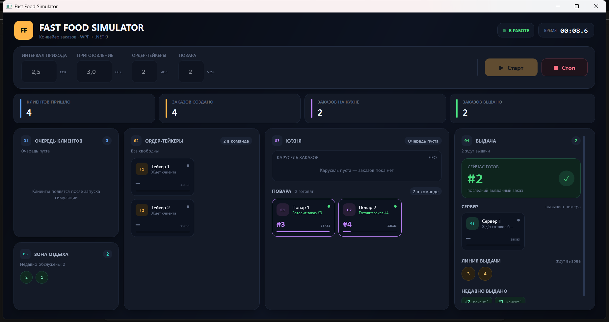

# Fast Food Simulator — WPF

Симулятор закусочной на **C# / WPF / .NET 9**.

Единственный проект решения — `FastFoodSimulator`

Запуск из консоли тоже работает:

## Скриншот



## Возможности

- Настройка интервала прихода клиентов и времени приготовления заказа.
- Произвольное количество ордер-тейкеров и поваров: от 1 до 100.
- Проверка ввода с понятными сообщениями об ошибках.
- Кнопки **Старт** и **Стоп**.
- Все сотрудники начинают работу сразу после запуска.
- Первый клиент приходит в момент старта, следующие — через заданный интервал.
- Повара готовят заказы параллельно, каждый — за заданное время.
- Визуализация:
  - очередь клиентов;
  - ордер-тейкеры с текущими заказами;
  - карусель заказов и очередь кухни;
  - повара с прогрессом приготовления;
  - сервер и линия выдачи;
  - недавно выданные заказы и зона отдыха.
- Статистика по клиентам, созданным, готовящимся и выданным заказам.

## Как работает

1. **Клиент** приходит по фиксированному интервалу и встаёт в очередь.
2. **Ордер-тейкер** берёт клиента, создаёт тикет с уникальным номером, тратит
   фиксированное время на оформление и отправляет тикет на кухню.
3. **Повар** берёт тикет из FIFO-очереди, готовит заказ заданное пользователем время
   и передаёт его серверу.
4. **Сервер** вызывает номер, клиент забирает заказ и переходит в зону отдыха.

В `Models/OrderTicket.cs` используются два Promise:

```csharp
public Task<OrderTicket> ReadyForService { get; } // ожидание сервера, пока повар готовит
public Task<OrderTicket> ReadyForPickup  { get; } // ожидание клиента на линии выдачи
```

## Структура

```text
FastFoodSimulator.sln
FastFoodSimulator/
  FastFoodSimulator.csproj
  Program.cs               # точка входа Main()
  MainWindow.xaml          # интерфейс
  Models/
    Customer.cs
    OrderTicket.cs         # два Promise
    OrderAnnouncement.cs
  Simulation/
    SimulationEngine.cs    # клиенты, тейкеры, повара, сервер
    SimulationOptions.cs   # интервалы и количество сотрудников
    SimulationSnapshot.cs  # неизменяемый снимок для UI
    AsyncQueue.cs
    ActorRuntime.cs
  ViewModels/
  Converters/
  Resources/Theme.xaml
```

UI обновляется раз в 100 мс по неизменяемому снимку состояния. Логика симуляции
не зависит от WPF и не использует сторонних библиотек.
